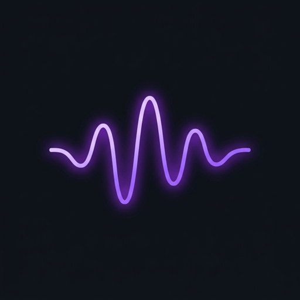
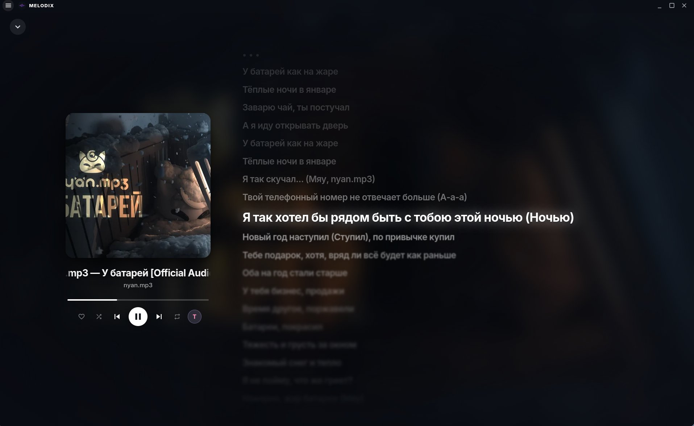
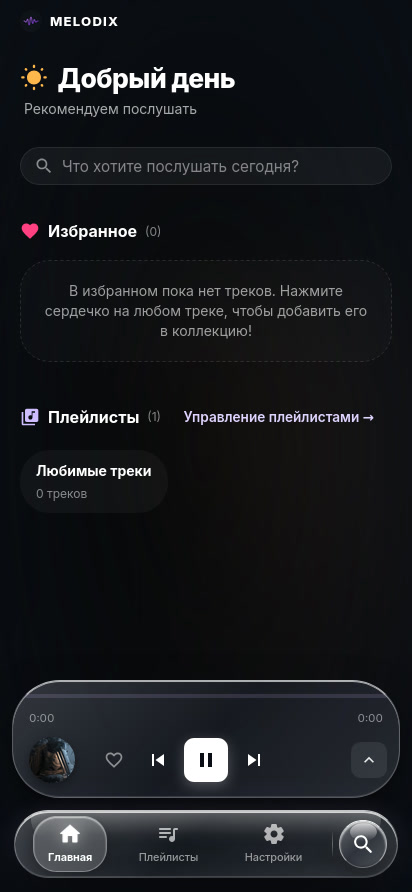
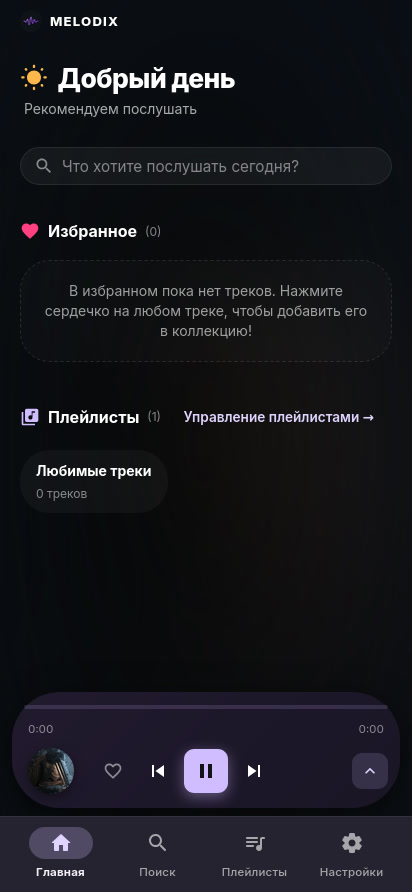
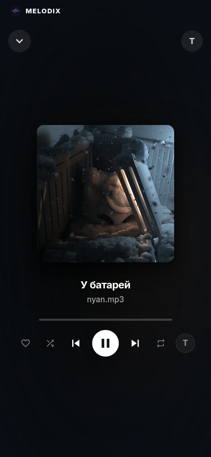
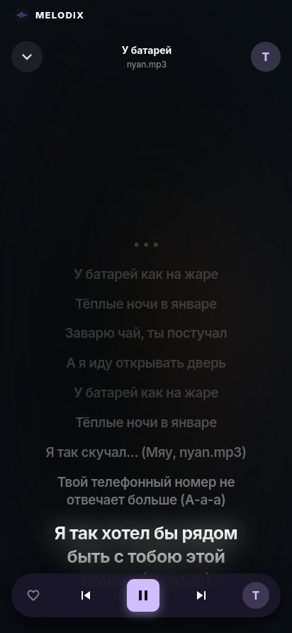

<p align="center">
  
</p>

<h1 align="center">Melodix (v1.2.0)</h1>

<p align="center">
  <strong>English</strong> | <a href="README.ru.md">Русский</a> | <a href="https://qvkap.github.io/Melodix/">Website</a>
</p>

<p align="center">
  Cross-platform music player for Android, iOS, Linux, Windows, and macOS with synchronized lyrics, adaptive cover backgrounds, local library playback, and playlist import.
</p>

<p align="center">
  
</p>

<p align="center">
  
  
  
  
</p>

---

## Features

- **Cross-Platform**: Electron desktop builds for Linux (AppImage, deb), Windows (NSIS, Portable, ZIP), and macOS (DMG, ZIP), plus Capacitor mobile builds for Android and iOS.
- **Synced Lyrics & Translation**: Line-by-line and word-by-word LRC lyrics with timing offset calibration, click-to-seek, and automatic RU/EN line translation.
- **Adaptive Backgrounds**: Dominant color extraction from album artwork with cached palettes and multiple material modes (`Apple Music`, `Ambient`, `Vibrant`, `Acrylic`, `Glow`, `Liquid Glass`, `None`).
- **Audio & Playback**: Equal-power crossfade with next-track preloading, HLS support, YouTube/YouTube Music search with SoundCloud fallback, and built-in HTTP/SOCKS proxy configuration.
- **Playlist Import & Local Library**: Import playlists from Yandex Music, Apple Music, and Spotify; scan local folders with tag and cover parsing.
- **System Integration**: Linux MPRIS controls, Wayland flags, Windows/macOS system accent color sync, Last.fm scrobbling, and background `yt-dlp` updates.

---

## Download

Prebuilt binaries are available on the [Releases](https://github.com/qvkap/Melodix/releases/latest) page:

| Platform | Formats | Notes |
| :--- | :--- | :--- |
| **Linux** | `.AppImage`, `.deb` | Wayland and X11 support |
| **Windows** | `.exe` (NSIS / Portable), `.zip` | Installer or portable build |
| **macOS** | `.dmg`, `.zip` | Unsigned CI build |
| **Android** | `Melodix-*-universal.apk` | Universal APK |
| **iOS** | `Melodix-*.ipa` | Unsigned IPA for sideloading |

---

## Build from Source

```bash
git clone https://github.com/qvkap/Melodix.git
cd Melodix
npm install
```

### Desktop (Electron + Vite)

```bash
# Development mode
npm run dev

# Production build
npm run build
```

### Mobile (Capacitor)

```bash
npx vite build
npx cap sync

# Open native projects
npx cap open android
npx cap open ios
```

---

## License

[GPL-3.0-or-later](LICENSE)
