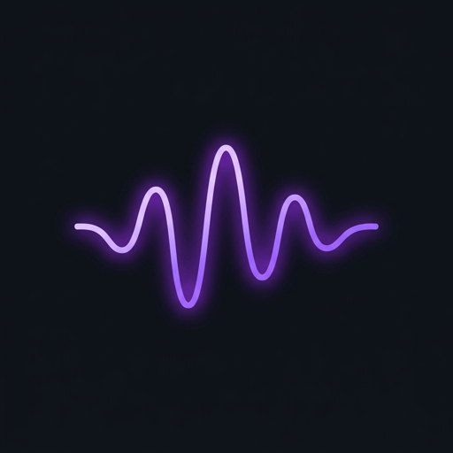
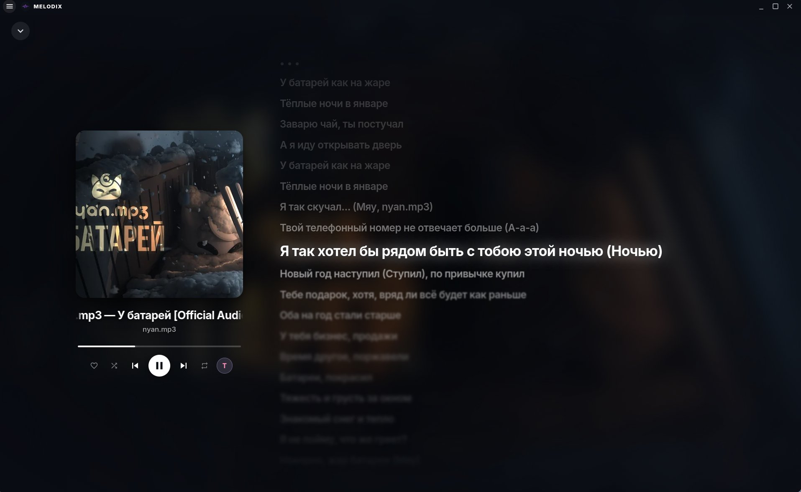
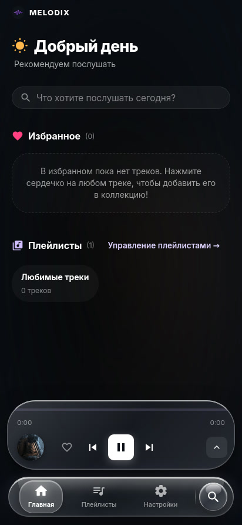
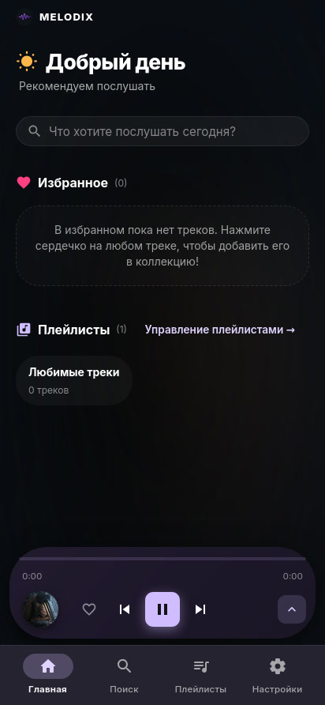
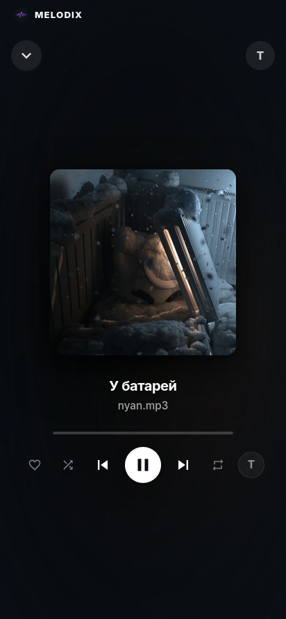
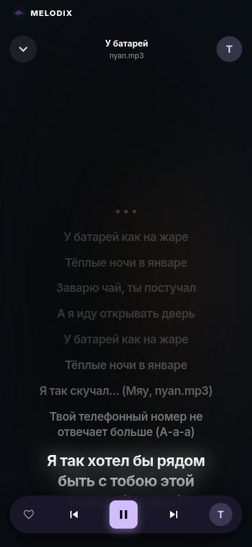

<p align="center">
  
</p>

<h1 align="center">Melodix (v1.2.0)</h1>

<p align="center">
  <a href="README.md">English</a> | <strong>Русский</strong> | <a href="https://qvkap.github.io/Melodix/">Сайт</a>
</p>

<p align="center">
  Кроссплатформенный музыкальный плеер для Android, iOS, Linux, Windows и macOS с синхронизированными текстами песен, адаптивным фоном, локальной медиатекой и импортом плейлистов.
</p>

<p align="center">
  
</p>

<p align="center">
  
  
  
  
</p>

---

## Возможности

- **Кроссплатформенность**: сборки для Linux (`AppImage`, `deb`), Windows (`NSIS`, `Portable`, `ZIP`), macOS (`DMG`, `ZIP`), а также мобильные сборки для Android и iOS на базе Capacitor.
- **Синхронный текст и перевод**: построчный и пословный LRC-текст с калибровкой задержки, перемоткой по клику на строку и автопереводом на русский или английский.
- **Адаптивный фон**: извлечение палитры из обложки с кешированием цветов и выбором режима оформления (`Apple Music`, `Ambient`, `Vibrant`, `Acrylic`, `Glow`, `Liquid Glass`, `None`).
- **Звук и потоки**: плавный кроссфейд с предзагрузкой следующего трека, поддержка HLS, поиск по YouTube / YouTube Music с резервным источником SoundCloud и встроенный прокси (HTTP/SOCKS5).
- **Импорт плейлистов и локальные файлы**: перенос плейлистов из Яндекс Музыки, Apple Music и Spotify; сканирование локальных папок с чтением тегов и обложек.
- **Интеграция с системой**: управление через MPRIS и поддержка Wayland на Linux, системный акцентный цвет на Windows/macOS, скробблинг в Last.fm и автообновление `yt-dlp`.

---

## Скачать

Готовые сборки доступны на странице [Releases](https://github.com/qvkap/Melodix/releases/latest):

| Платформа | Форматы | Примечание |
| :--- | :--- | :--- |
| **Linux** | `.AppImage`, `.deb` | Поддержка Wayland и X11 |
| **Windows** | `.exe` (NSIS / Portable), `.zip` | Установщик или портативная версия |
| **macOS** | `.dmg`, `.zip` | Неподписанная сборка из CI |
| **Android** | `Melodix-*-universal.apk` | Универсальный APK |
| **iOS** | `Melodix-*.ipa` | Неподписанный IPA для sideloading |

---

## Сборка из исходного кода

```bash
git clone https://github.com/qvkap/Melodix.git
cd Melodix
npm install
```

### Десктоп (Electron + Vite)

```bash
# Режим разработки
npm run dev

# Сборка пакета
npm run build
```

### Мобильные платформы (Capacitor)

```bash
npx vite build
npx cap sync

# Открыть проект в IDE
npx cap open android
npx cap open ios
```

---

## Лицензия

[GPL-3.0-or-later](LICENSE)
